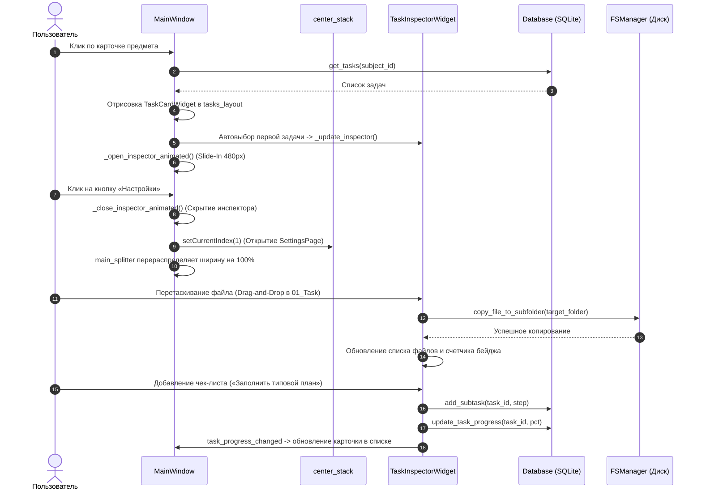

# UniVault — Архитектурная документация проекта (ARCHITECTURE.md)

> **Назначение документа**: Данный файл содержит исчерпывающее описание архитектуры, структуры базы данных, файловой системы, пользовательского интерфейса (PySide6) и сценариев взаимодействия проекта **UniVault**.  
> **Для ИИ-ассистентов и разработчиков**: Перед внесением изменений в код изучите этот документ, чтобы точно знать, в каком модуле находится нужная логика, какие сигналы используются и какие ограничения необходимо соблюдать.

---

## 1. Обзор проекта и стек технологий

**UniVault** — высокопроизводительное десктопное приложение для ОС Windows, сочетающее в себе функции локального академического файлового менеджера и трекера учебных дедлайнов (лабораторных, практических и курсовых работ).

### Ключевые принципы архитектуры:
- **Zero-Border Material Design 3 Expressive**: Современный интерфейс без жестких белых рамок, с мягкими тенями, динамическими палитрами Google Pixel Monet Engine и настраиваемым матовым стеклом (Frosted Glass).
- **Двусторонняя синхронизация**: База данных SQLite хранит метаданные, статусы и чек-листы, а файлы хранятся в строгой и прозрачной структуре каталогов на диске, доступной как из приложения (Drag-and-Drop), так и через Проводник Windows.
- **Строгая модульность**: Четкое разделение ответственности между БД (`src/database.py`), файловой системой (`src/fs_manager.py`) и графическим интерфейсом (`src/ui/`).
- **Стек**:
  - **Язык**: Python 3.11+ (строгая типизация `from __future__ import annotations`, `pathlib.Path`).
  - **GUI Фреймворк**: PySide6 (Qt 6 for Python).
  - **База данных**: Встроенная SQLite3 с поддержкой внешних ключей (`PRAGMA foreign_keys = ON;`).
  - **Генерация документов**: `python-docx` для автоматического создания отчетов.

---

## 2. Карта модулей и файлов (Codebase Map)

```
c:\Prog\
├── main.py                     # Точка входа приложения, инициализация QApplication и DI
├── SPEC.md                     # Исходное техническое задание (PRD)
├── Rules.md                    # Базовые правила и конвенции разработки
├── ARCHITECTURE.md             # Настоящий мастер-документ архитектуры
├── test_core.py                # Модульные тесты файловой системы и базы данных
├── test_ui.py                  # Автотесты графического интерфейса и диалогов (offscreen)
│
├── src/
│   ├── __init__.py
│   ├── database.py             # Схема SQLite, модели Dataclass (Subject, Task), CRUD методы
│   ├── fs_manager.py           # Логика дисковых операций, санитизация путей, docx и zip
│   │
│   ├── resources/
│   │   └── fonts/              # Локальные шрифты Google Roboto (56 TTF начертаний)
│   │
│   └── ui/
│       ├── __init__.py
│       ├── main_window.py      # Главное окно (MainWindow), трехпанельный сплиттер, навигация
│       ├── cards.py            # Интерактивные карточки предметов и задач (Hover Lift, бейджи)
│       ├── file_inspector.py   # Правая панель инспектора задачи: Drag-and-Drop, файлы, чек-лист
│       ├── settings_page.py    # Полноэкранная страница настроек (темы, кастомные цвета, профиль)
│       ├── modal_overlay.py    # Внутриоконный модальный оверлей (InWindowModalOverlay) с анимацией
│       ├── dialogs.py          # Диалоги добавления предметов (AddSubjectDialog) и задач (AddTaskDialog)
│       ├── theme.py            # Палитры Monet Engine, шкала прозрачности, генератор стилей QSS
│       ├── icons.py            # Генератор Material Design SVG иконок с динамическим окрашиванием
│       ├── styles.py           # Устаревшие базовые QSS (исторический fallback)
│       └── task_card.py        # Альтернативный/устаревший рендерер карточки (fallback)
```

---

## 3. Модели данных и схема SQLite (`src/database.py`)

База данных SQLite (`univault.db`) автоматически создается и инициализируется методом `Database._init_db()`.  
Включение каскадного удаления: `PRAGMA foreign_keys = ON;`.

### 3.1. Таблицы базы данных

#### 1. `settings` (Глобальные настройки ключ-значение)
| Поле | Тип | Описание |
|---|---|---|
| `key` | `TEXT PRIMARY KEY` | Имя параметра (`theme_name`, `theme_mode`, `custom_color`, `custom_colors`, `window_opacity`, `student_name`, `student_group`, `student_variant`, `root_path`, `minimize_to_tray`, `notifications_enabled`) |
| `value` | `TEXT` | Сериализованное значение (строка, float, boolean "true"/"false", или JSON-список для кастомных цветов) |

#### 2. `subjects` (Учебные дисциплины)
| Поле | Тип | Описание |
|---|---|---|
| `id` | `INTEGER PRIMARY KEY AUTOINCREMENT` | Уникальный ID предмета |
| `name` | `TEXT NOT NULL` | Полное название (напр. «Информационная безопасность») |
| `short_name` | `TEXT` | Краткий тег/аббревиатура (напр. «ИБ») |
| `teacher_name` | `TEXT` | ФИО преподавателя |
| `exam_type` | `TEXT` | Форма контроля: `Экзамен`, `Зачет`, `Диф. зачет` |
| `folder_path` | `TEXT NOT NULL` | Относительное имя директории предмета на диске |
| `color_hex` | `TEXT NOT NULL` | Цвет маркера в UI (HEX, по умолчанию `#8AB4F8`) |

#### 3. `tasks` (Практические, лабораторные и курсовые работы)
| Поле | Тип | Описание |
|---|---|---|
| `id` | `INTEGER PRIMARY KEY AUTOINCREMENT` | Уникальный ID работы |
| `subject_id` | `INTEGER NOT NULL` | Внешний ключ `FOREIGN KEY -> subjects(id) ON DELETE CASCADE` |
| `number` | `INTEGER NOT NULL` | Порядковый номер работы (1, 2, 3...) |
| `type` | `TEXT NOT NULL` | Тип: `Практическая`, `Лабораторная`, `Курсовая`, `Реферат` |
| `title` | `TEXT NOT NULL` | Название/тема работы |
| `variant` | `TEXT` | Номер варианта (напр. «Вариант 1») |
| `status` | `TEXT NOT NULL` | Статус из фиксированного перечня (см. константы ниже) |
| `progress_percent`| `INTEGER DEFAULT 0`| Процент выполнения (0–100%) |
| `deadline_date` | `TEXT` | Дедлайн в формате ISO `YYYY-MM-DD HH:MM` |
| `completed_date`| `TEXT` | Дата фактической сдачи |
| `score` | `REAL` | Полученные баллы/оценка |
| `notes` | `TEXT` | Заметки, комментарии преподавателя, правки |
| `folder_path` | `TEXT NOT NULL` | Относительное имя папки работы на диске |

#### 4. `subtasks` (Чек-лист этапов работы)
| Поле | Тип | Описание |
|---|---|---|
| `id` | `INTEGER PRIMARY KEY AUTOINCREMENT` | Уникальный ID подзадачи |
| `task_id` | `INTEGER NOT NULL` | Внешний ключ `FOREIGN KEY -> tasks(id) ON DELETE CASCADE` |
| `title` | `TEXT NOT NULL` | Описание этапа (напр. «Написать скрипт парсера») |
| `is_done` | `INTEGER DEFAULT 0` | Флаг выполнения (`0` или `1`) |

### 3.2. Статусы задач и прогресс

Константы статусов объявлены в `src/database.py`:
- `STATUS_NOT_STARTED = "NOT_STARTED"` («Не начато», 0%)
- `STATUS_IN_PROGRESS = "IN_PROGRESS"` («В работе», 30%)
- `STATUS_REPORTING = "REPORTING"` («Оформление отчета», 60%)
- `STATUS_WAIT_DEFENSE = "WAIT_DEFENSE"` («Ждет защиты», 85%)
- `STATUS_REWORK = "REWORK"` («На доработке», 50%)
- `STATUS_COMPLETED = "COMPLETED"` («Сдано», 100%)

### 3.3. Логика срочности дедлайнов и горящие задачи
- **Функция `is_deadline_hot(deadline_date, status)`**:
  Определяет, считается ли дедлайн критическим/горящим (осталось < 72 часов или просрочено). Задачи со статусом `COMPLETED` или `WAIT_DEFENSE` никогда не считаются горящими.
- **Метод `Database.get_tasks(..., order_by_deadline=True, only_hot=True)`**:
  Позволяет получить задачи, отсортированные по близости дедлайна (просроченные и ближайшие первыми, задачи без дедлайна в конце) либо с фильтрацией `only_hot=True`.
- **Метод `Database.get_hot_tasks(subject_id=None)`**:
  Возвращает все активные горящие задачи по конкретному предмету или по всем дисциплинам сразу.
- **Метод `Database.get_deadline_stats()`**:
  Возвращает словарь агрегированных показателей дедлайнов: `total_active`, `overdue`, `critical_24h`, `warning_3d`, `normal`, `no_deadline`, `hot_count`.

---

## 4. Архитектура файловой системы (`src/fs_manager.py`)

Все пути на диске обрабатываются строго через объектную модель `pathlib.Path`.

### 4.1. Физическая структура каталогов Workspace

```
<Root_Workspace>/                     # Например: C:\Prog\Workspace
├── _Templates/                       # Глобальные шаблоны (.docx отчетов, титульников)
│   └── Шаблон_Отчета.docx
├── [Subject_Folder]/                 # Имя: <Name>_<Tag> (санитизировано)
│   ├── _Materials/                   # Лекции, литература, вопросы к зачету
│   │
│   └── [Task_Folder]/                # Имя: <Тип>_<Номер>_<Тема> (санитизировано)
│       ├── 01_Task/                  # Условия задач, ТЗ, методички
│       ├── 02_Workspace/             # Исходный код, скрипты, черновики
│       └── 03_Submission/            # Итоговый отчет .docx и архивы .zip на сдачу
```

### 4.2. Имена подпапок (Константы `FSManager`):
- `SUBFOLDER_TASK = "01_Task"`
- `SUBFOLDER_WORKSPACE = "02_Workspace"`
- `SUBFOLDER_SUBMISSION = "03_Submission"`
- `FOLDER_TEMPLATES = "_Templates"`
- `FOLDER_MATERIALS = "_Materials"`

### 4.3. Автогенерация отчетов и архивов
- **Генерация отчета (`generate_task_report`)**:
  Автоматически берет шаблон из `_Templates`, подставляет ФИО студента, группу, предмет, тему работы и номер варианта через библиотеку `docx`, сохраняя файл в папку `03_Submission`.
  > **ВНИМАНИЕ**: Логика метода `FSManager.generate_task_report` стабилизирована и протестирована. Не модифицируйте данный метод без явного запроса пользователя.
- **Архивация (`create_submission_zip`)**:
  Упаковывает файлы из `02_Workspace` и финальный отчет из `03_Submission` в zip-архив для отправки преподавателю и копирует путь в буфер обмена Windows.

---

## 5. UI/UX Архитектура и дизайн-система

Пользовательский интерфейс построен на PySide6 в соответствии с принципами **Material Design 3 Expressive**.

### 5.1. Трехколоночная архитектура (`MainWindow`)

Экран приложения управляется через горизонтальный `QSplitter` (`main_splitter`), в который вложены три ключевых зоны:

1. **Левая колонка — Navigation Drawer (фиксированная ширина ~290px)**:
   - Кнопка **«Настройки»** (`settings_btn`, высота 42px).
   - Кнопка **«Все практические работы»** (`all_tasks_btn`, высота 48px).
   - Кнопка **«Горящие дедлайны»** (`dashboard_btn`, высота 48px) с динамическим бейджем количества горящих задач (красный овал при > 0).
   - Заголовок секции предметов + кнопка **«+ Добавить»** (`add_subj_btn`, открывает `AddSubjectDialog`).
   - Скролл-список карточек предметов (`SubjectCardWidget`), отображающий прогресс сдачи (например, `2/5 • 40%`).
   - Нижняя плашка рабочей папки («Корневая папка»).

2. **Центральная колонка — Central Stack (`QStackedWidget`)**:
   - **Index 0 — Рабочая область (`workspace_content`)**:
     - Верхний Hero-блок: заголовок активного контекста (в режиме дашборда: «Горящие дедлайны» и статистика `просрочено: X • <24ч: Y • <3 дней: Z`), счетчик работ, кнопка **«+ Новая работа»**.
     - Панель поиска (`search_input`) и фильтр по статусам (`status_filter_combo`, включающий опцию «🔥 Только горящие»).
     - Скролл-область списка карточек задач (`TaskCardWidget`), отсортированных по близости дедлайна с цветовой индикацией срочности.
   - **Index 1 — Страница настроек (`settings_page`)**:
     - Полноэкранный вид `SettingsPageWidget`, перекрывающий центральную зону.
     - Содержит секции: профиль студента, темы оформления Monet Engine, матовое стекло, управление хранилищем и карточку **«УВЕДОМЛЕНИЯ И СИСТЕМНЫЙ ТРЕЙ»** (`minimize_to_tray`, `notifications_enabled`, кнопка ручной проверки дедлайнов).
     - **При переходе в настройки инспектор автоматически сворачивается и скрывается**, а сплиттер отдает настройкам 100% ширины рабочего стола.

3. **Правая колонка — Inspector Sheet (`right_widget`, ширина 480px)**:
   - Выдвижная панель с плавной анимацией ширины (`_open_inspector_animated` / `_close_inspector_animated`).
   - Содержит `TaskInspectorWidget`:
     - Шапка задачи: быстрое редактирование статуса через комбобокс, слайдер прогресса (0–100%), индикатор срока дедлайна.
     - 3 Drag-and-Drop секции (`FileDropZoneSection`): `01_Task`, `02_Workspace`, `03_Submission`.
     - Кнопки быстрого действия: запуск VS Code (`code .`), генерация отчета Word, упаковка ZIP.
     - Секция чек-листа подзадач: центрированная кнопка типового плана (4 этапа), поле ввода нового этапа, список строк подзадач `SubtaskItemWidget` с чекбоксами и удалением.
     - Поле заметок и замечаний преподавателя.

### 5.2. Система тем Google Pixel Monet Engine (`src/ui/theme.py`)

Приложение поддерживает переключение между **Dark** и **Light** темами с пятью базовыми палитрами Google Pixel + поддержка кастомного пользовательского акцента:
1. `pixel_blue` (Pixel Sapphire) — `#A8C7FA` (Dark) / `#1A73E8` (Light)
2. `emerald` (Pixel Emerald) — `#80D999` (Dark) / `#1E8E3E` (Light)
3. `lavender` (Pixel Lavender) — `#D0BCFF` (Dark) / `#7C4DFF` (Light)
4. `rose` (Pixel Rose Quartz) — `#FFB2B8` (Dark) / `#D93025` (Light)
5. `sand` (Pixel Desert Gold) — `#E5C367` (Dark) / `#855B00` (Light)
6. `custom` — динамическая палитра, программно генерируемая из любого HEX-цвета методом `generate_custom_palette(hex, is_dark)`.

### 5.3. Дифференцированная прозрачность (Frosted Glass)

Слайдер прозрачности в настройках (10% — 100%) регулирует плотность матового стекла:
- **Оконные фоны и подложка** (`panel_bg`, `center_bg`) сильнее реагируют на изменение прозрачности для создания выразительного эффекта размытия.
- **Передние карточки, кнопки и поля ввода** (`card_bg`, `card_hover`, `input_bg`) сохраняют высокую плотность и контрастность (удержание >80% в светлой теме), предотвращая выцветание текста и фонов.

### 5.4. Внутриоконный модальный слой (`InWindowModalOverlay`)

Диалоги создания предметов и задач отображаются поверх интерфейса с помощью `InWindowModalOverlay`:
- Создает затемняющий бэкдроп внутри окна без открытия отдельных независимых окон ОС Windows.
- Плавная анимация появления подложки через `_backdrop_opacity` в `paintEvent` (исключает конфликты вложенных `QGraphicsEffect` и мерцание дочерних виджетов на Windows).
- Карточка плавно всплывает по центру (Slide Up от `y + 20` до `y`).
- **Истинная модальность**: случайные клики по подложке поглощаются и не закрывают диалог, защищая вводимые данные от потери при мискликах, закрытии выпадающих календарей или комбобоксов.
- Удобное и явное закрытие: кнопка **«Отмена»**, кнопка-крестик **[✕]** в правом верхнем углу шапки, либо клавиша **Escape**.
- Явное сохранение ссылки `self._active_dialog` в `MainWindow` на время модальной сессии для защиты от преждевременной сборки мусора (GC).

### 5.5. Системный трей Windows и уведомления о дедлайнах (`QSystemTrayIcon`)

- **Интеграция с треем**:
  - `QSystemTrayIcon` инициализируется при старте приложения с контекстным меню: «Открыть UniVault», «Горящие дедлайны», «Проверить дедлайны», «Выход».
  - Поддерживается перехват события закрытия окна (`closeEvent`): если в настройках включен параметр `minimize_to_tray`, окно скрывается в трей с показом информационного toast-сообщения.
  - Метод `_force_quit()` позволяет безусловно завершить работу приложения из меню трея.
- **Фоновый мониторинг дедлайнов**:
  - Фоновый таймер `QTimer` каждые 2 часа (а также однократно при старте) запускает метод `check_deadlines_and_notify()`.
  - Уведомления группируются по уровням срочности: `overdue` (просрочено), `critical` (<24 ч), `warning` (<72 ч / <3 дней).
  - Исключение повторов: словарь `_last_notified_tiers` хранит дату последней нотификации для каждого уровня.
  - При клике на уведомление (`_on_tray_message_clicked`) окно разворачивается, автоматически находит и выделяет критическую задачу в списке и открывает инспектор.

---

## 6. Потоки данных и ключевые сигналы (Data Flow)



---

## 7. Памятка для разработчиков и ИИ: "Где что менять"

| Задача / Симптом | Где находится код | На что обратить внимание |
|---|---|---|
| **Добавить/изменить поле задачи или предмета** | `src/database.py` | Обновить SQL-схему в `_init_db`, методы `add_task`/`update_task` и dataclass `Task` / `Subject`. |
| **Изменить палитру, цвет, прозрачность или базовый QSS** | `src/ui/theme.py` | Словари `PIXEL_THEMES_DARK`/`LIGHT`, функция `scale_palette_opacity` и `build_global_stylesheet`. |
| **Изменить внешний вид карточек задач или предметов** | `src/ui/cards.py` | Классы `TaskCardWidget` и `SubjectCardWidget`. Помнить про запас `margins` сверху для анимации Hover Lift. |
| **Изменить инспектор, файловые зоны или чек-лист** | `src/ui/file_inspector.py` | `TaskInspectorWidget`, `FileDropZoneSection`, `SubtaskItemWidget`. Для кнопок задавать точные `min-height` и `max-height`. |
| **Изменить страницу настроек, сохранение цвета/профиля** | `src/ui/settings_page.py` | `SettingsPageWidget`. Сохранение кастомных цветов происходит в `settings` ключ `custom_colors`. |
| **Поведение модальных диалогов создания** | `src/ui/dialogs.py`, `src/ui/modal_overlay.py` | `AddSubjectDialog`, `AddTaskDialog`. Диалоги должны наследоваться от `QDialog` и встраиваться в `modal_overlay`. |
| **Поведение бокового меню, фильтрации и сплиттера** | `src/ui/main_window.py` | Методы `_open_settings_dialog`, `_open_inspector_animated`, `_close_inspector_animated`, перерасчет `main_splitter.setSizes()`. |
| **Генерация .docx отчета и шаблоны** | `src/fs_manager.py` | Метод `generate_task_report`. Не трогать без крайней необходимости. |

---

## 8. Критические табу и правила проекта (Golden Rules)

1. **Не ломать генератор отчетов**: Метод `FSManager.generate_task_report` в `src/fs_manager.py` строго выверен под структуру `.docx` шаблонов. Запрещено его удалять, упрощать или заменять сторонними генераторами.
2. **Работать строго в текущей директории**: Все действия выполнять только в рабочей директории `c:\Prog`. Запрещено создавать внешние дубликаты папки проекта.
3. **Безопасность стилей кнопок PySide6**:
   В `src/ui/theme.py` задан глобальный стиль `QPushButton { min-height: 42px; padding: 0 20px; }`. При создании компактных кнопок (например, чипов, кнопок внутри карточек или инспектора) **всегда явно прописывайте** `min-height`, `max-height` и `padding` в локальном `setStyleSheet()`, иначе глобальный стиль растянет кнопку.
4. **Синхронизация QSplitter**: При скрытии или анимации правого инспектора (`right_widget`) обязательно обновляйте пропорции сплиттера через `self.main_splitter.setSizes([sidebar_w, center_w, inspector_w])`, чтобы центральная часть занимала свободное место без пустых белых полос.
5. **Проверка после изменений**:
   Всегда компилируйте измененные файлы через `python -m py_compile <path>` и запускайте быстрые тесты `python test_core.py` и `python test_ui.py`.
